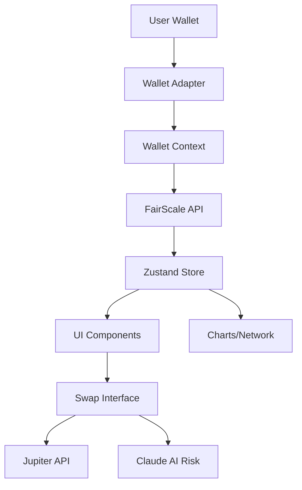

# TrustSwap - FairScale-Powered Solana DEX


## The Problem
DeFi treats all users equally. Bots exploit systems. No reward for trust.

## The Solution  
TrustSwap uses FairScale reputation to create tiered trading:
- 🥉 **Bronze (0-299)**: Standard fees, basic access
- 🥈 **Silver (300-599)**: 40% fee discount, higher limits
- 🥇 **Gold (600-799)**: 80% fee discount, exclusive pools
- 💎 **Diamond (800+)**: 0% fees, unlimited, VIP features

---

## 🚀 Features

### Score-Gated Access ✅
- **Diamond Pool**: Exclusive tokens for 800+ scores
- **Tiered Fees**: Dynamic fee discounts based on your FairScore
- **Loyalty XP**: Earn XP for every trade to climb ranks

### Risk Management ✅
- **AI Risk Analyzer**: Powered by Claude API to assess trade risk in real-time
- **Reputation Staking**: Stake your score for double rewards (with risk!)
- **Trust Network**: Visualize your on-chain connections

### Unique Innovations 💎
- **Real-time FairScale API Integration**
- **Interactive React Flow Trust Graph**
- **Jupiter Aggregator Swap Execution**
- **Beautiful Glassmorphism UI**

---

## 🛠 Tech Stack

- **Frontend**: Next.js 14, React, TypeScript, TailwindCSS
- **Blockchain**: Solana Web3.js, Wallet Adapter
- **DeFi**: Jupiter Aggregator API
- **Data**: FairScale API, Recharts
- **AI**: Anthropic Claude API (Mocked for Demo)
- **Visuals**: Framer Motion, React Flow, Particles

---

## 📦 Quick Start

### Prerequisites
- Node.js 18+
- Solana Wallet (Phantom, Backpack, Solflare)

### Installation

1. Clone the repository:
```bash
git clone https://github.com/Demiladepy/trustswap.git
cd trustswap
```

2. Install dependencies:
```bash
npm install --legacy-peer-deps
```

3. Run development server:
```bash
npm run dev
```

4. Open [http://localhost:3000](http://localhost:3000)

---

## 🔧 Configuration

Create a `.env.local` file:

```env
NEXT_PUBLIC_FAIRSCALE_API_URL=https://api.fairscale.xyz/
NEXT_PUBLIC_SOLANA_RPC_URL=https://api.mainnet-beta.solana.com
```

---

## 🧩 Architecture



---

## 🔮 Roadmap

- [x] Phase 1: Core UI & Tier System
- [x] Phase 2: Wallet Integration
- [x] Phase 3: Swap Functionality
- [x] Phase 4: Leaderboard & Quests
- [x] Phase 5: AI Integration (MVP)
- [ ] Phase 6: Mainnet Launch
- [ ] Phase 7: Mobile App

---

## 🏆 Hackathon Notes

This project was built for the **FairScale Bounty**. 
Key differentiators:
1. **AI Integration**: Specific risk analysis for every trade.
2. **Reputation Staking**: Novel mechanism to leverage social capital.
3. **Visual Excellence**: Premium design system and animations.

---

*(c) 2026 TrustSwap Team*
